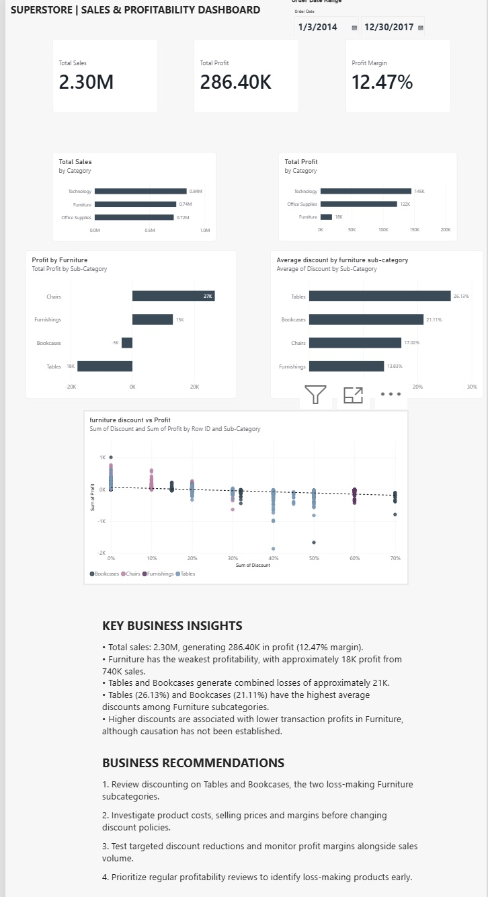

# Retail Sales Performance Analysis | Power BI

## Project Overview

An end-to-end retail sales analytics project using **Power BI, Power Query and DAX** to analyse historical sales performance, profitability and discounting patterns.

The project investigates why certain product categories generate substantial revenue but relatively low profit, with a particular focus on the Furniture category.

**Analysis period:** 2014–2017  
**Dataset:** Sample Superstore  
**Tools:** Power BI Desktop, Power Query, DAX, GitHub

## Dashboard Preview



## Business Questions

- Which product categories generate the highest sales and profits?
- Why does Furniture generate relatively low profit despite strong sales?
- Which Furniture subcategories are loss-making?
- What relationship exists between discounts and transaction profitability?
- What actions could improve profitability?

## Data Preparation

The dataset contains 9,994 sales transaction records.

Using Power Query, I:

- Reviewed data types and column quality.
- Checked key sales, profit, discount and date fields for missing values and errors.
- Created a Shipping Days column by calculating the difference between Ship Date and Order Date.
- Validated the shipping duration calculations before loading the data into Power BI.

## DAX Measures

**Total Sales**

```dax
Total Sales = SUM('sales_transactions'[Sales])
```

**Total Profit**

```dax
Total Profit = SUM('sales_transactions'[Profit])
```

**Profit Margin**

```dax
Profit Margin = DIVIDE([Total Profit], [Total Sales], 0)
```

## Key Findings

| Metric | Result |
|---|---|
| Total Sales | 2.30M |
| Total Profit | 286.40K |
| Overall Profit Margin | 12.47% |
| Furniture Sales | Approximately 740K |
| Furniture Profit | Approximately 18K |
| Tables Profit | Approximately -18K |
| Bookcases Profit | Approximately -3K |

Technology generated the highest category sales and profit.

Furniture generated substantial sales but had significantly weaker profitability than Technology and Office Supplies.

Within Furniture, Tables and Bookcases recorded combined losses of approximately 21K.

Tables had the highest average discount at 26.13%, followed by Bookcases at 21.11%.

Transaction-level analysis showed an association between higher discounts and lower profit. However, this relationship does not establish that discounts alone caused the losses.

## Business Recommendations

1. Review discount policies for Tables and Bookcases.
2. Investigate product costs, selling prices and profitability before implementing changes.
3. Test targeted discount adjustments while monitoring sales volume and profit margins.
4. Establish regular subcategory profitability reviews to identify underperforming products.

## Interactive Dashboard Features

- Sales, profit and profit-margin KPI cards.
- Sales and profit comparisons by category.
- Furniture subcategory profitability analysis.
- Average discount comparisons.
- Discount-versus-profit scatter plot with trend line.
- Interactive order-date filtering.

## Project Files

- [Power BI Dashboard (.pbix)](superstore_dashboard_project.pbix)
- [Dashboard Screenshot](superstore_dashboard.JPG)

## Dataset Source

Sample Superstore dataset, accessed through the public GitHub repository [Victory-Data/Superstore-Sales-Dataset](https://github.com/Victory-Data/Superstore-Sales-Dataset).

## Skills Demonstrated

**Data cleaning | Data transformation | Power Query | DAX | Data visualisation | Business intelligence | Profitability analysis | Analytical storytelling**

---

*This project uses historical sample retail data for portfolio and educational purposes.*
